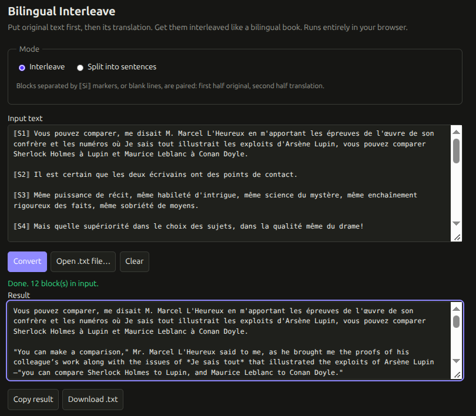

<div align="center">

# 📖 Bilingual Interleave

**Read translated documents like bilingual books.**

[](https://mnhqut.github.io/bilingual-interleave/)
[](requirements.txt)
[](LICENSE)



</div>

---

## 🌐 Web app — no install needed

> **👉 [Open the web app](https://mnhqut.github.io/bilingual-interleave/)**
>
> Paste or open a `.txt` file, pick a mode, and get the result in your browser. Works on phone and desktop. Nothing is uploaded: everything runs locally.

Supports sentence segmentation for **English, Spanish, French, German, Russian, Japanese, Chinese and Korean** 

---

## 💡 Why this exists

Language learners often translate long documents for reading practice. But when the original and the translation sit in separate sections, flipping back and forth becomes tedious.

**Bilingual Interleave** takes a document with the original text followed by its translation, and weaves them together:

```text
Original paragraph 1

Translated paragraph 1


Original paragraph 2

Translated paragraph 2
```

Each translation sits right next to its original, making long bilingual texts easier to read, compare and annotate.

---

## 🚀 Usage

### 1. Arrange your text

Use any translation service you like, then put **all original text first**, followed by **all translated text**:

```text
Original paragraph 1
Original paragraph 2
Original paragraph 3

Translated paragraph 1
Translated paragraph 2
Translated paragraph 3
```

The rules:
- An **even** number of blocks (paragraphs or sentences).
- First half = originals, second half = matching translations.

### 2. Pick a mode

| Mode | What it does |
| --- | --- |
| **Interleave** (default) | Pairs block *i* with block *n + i* and weaves them together. |
| **Split sentences** | Splits text into sentences, labelled `⟦S1⟧`, `⟦S2⟧`… so you can rearrange them and then interleave. |

### 3. Run it

**In the browser** — just open the [web app](https://mnhqut.github.io/bilingual-interleave/).

**From the command line:**

```bash
pip install -r requirements.txt
python -c "import nltk; nltk.download('punkt_tab')"   # one-time, for split mode

python3 interleave.py                                  # interleave input.txt
python3 interleave.py --mode split_sentence --language english
python3 interleave.py -i other.txt -o result.txt

# one step: split → translate (no API key) → interleave
python3 interleave.py --mode translate --target fr
python3 interleave.py --mode translate --source en --target vi --engine microsoft
```

`translate` mode sends your text to public web translation endpoints (Google, Microsoft Edge), batched, with automatic failover. Same approach as FluentRead; see [translation engine.md](translation%20engine.md). No key needed, but endpoints are unofficial and may rate-limit or change.

The result is copied to your clipboard and printed (or saved with `-o`).

---

## 🧭 How it works

```text
              ┌─────────────┐
 input.txt ──▶│ split blocks│──▶ translate ──▶ interleave ──▶ clipboard / file
              └─────────────┘
                     ▲
          ⟦Si⟧ markers or blank lines
```

Sentence-split output can be fed into Google Translate (or another Translation provider), then appended after the output of the  interleave mode, so the two modes chain: **split → translate → arrange → interleave**.

(Note: AI chatbox can also do this but we save a few tokens and electricity by doing this 😅)

---

## 🗂 Project layout

| Path | Purpose |
| --- | --- |
| `interleave.py` | Command-line tool (NLTK sentence segmentation). |
| `translate_engine.py` | Key-less translation engines (Google, Microsoft) with batching and failover. |
| `web/` | Static browser version: `index.html` + `interleave-core.js`. |
| `web/PROBLEMS.md` | Design notes and known differences from the Python version. |

---

## 🤝 Contributing

Contributions, bug fixes and new ideas are welcome. Open an issue or a pull request.

---

## 📜 License

Dedicated to the **public domain**. Use, modify, copy and redistribute freely. No attribution required.

---

<div align="center">

*Made for people who learn languages by reading.* 📚

</div>
